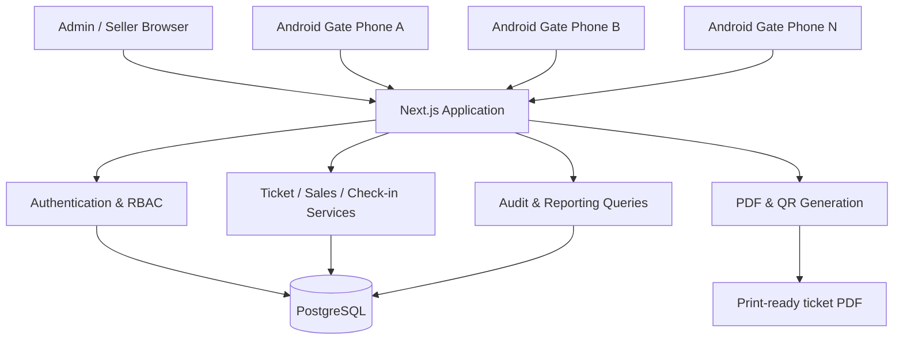

# Product Requirements Document (PRD)

# KSP Ticketing & Access Control System

Working name: **KSP GatePass**

| Item | Value |
| --- | --- |
| Release | MVP |
| Capacity | 500 tickets (configurable per event) |
| Platform | Android-first mobile PWA |
| Hosting | Self-hosted |
| Primary users | Event administrators, sellers and gate staff |
| Primary outcome | Sell genuine tickets and prevent duplicate entry |
| First deployment | One event, up to 500 tickets |
| Operating model | Online verification across multiple phones |

This is a self-hosted ticket sales and entrance verification system for KSP Hotel Gulu, designed for the first 500-ticket event and reusable for future events. It avoids expensive third-party ticketing fees while keeping ticket generation, sales, payments, QR scanning, manual serial verification and reporting under KSP's control.

The main architectural decision is a mobile-first Progressive Web App (PWA). Staff open it on Android phones in a browser, install it to the home screen, and use the camera to scan tickets, with no separate Android and web apps to maintain. Verification stays online so multiple phones can reject duplicate entries in real time.

This document is written as a build-ready specification for a coding agent: user roles, screens, database rules, workflows, API contracts, security and acceptance tests.

## 1. Product overview

### 1.1 Problem statement

KSP Hotel Gulu needs a cost-effective system to manage event tickets from creation to admission. It must support physically printed tickets, ticket sales, payment tracking, QR scanning and manual serial-number lookup.

Third-party platforms may charge fees that are hard to justify for a small event. A custom system lets KSP manage its own events, ticket inventory, staff accounts, admission records and sales reports.

The system must prevent the same ticket from being admitted twice, even when two staff members scan it at nearly the same time.

### 1.2 Product vision

A simple, secure and reusable event ticketing platform that a small team can operate using Android phones and a web browser, without specialised scanners or expensive ticketing subscriptions.

### 1.3 Goals

1. Create and manage events, ticket categories, prices and ticket limits.
2. Generate unique tickets and QR codes before printing.
3. Record sales and payments, including cash and manually confirmed mobile-money payments.
4. Verify tickets using a QR scanner or manually entered serial number.
5. Prevent duplicate admission through server-side, transaction-safe check-in.
6. Track who sold, paid for, cancelled, checked in or corrected each ticket.
7. Provide live attendance figures and sales reconciliation reports.
8. Reuse the system for future KSP events without rebuilding it.

### 1.4 Non-goals for the first release

- Automatic publishing or marketing campaigns.
- A public ticket marketplace or third-party event discovery platform.
- Automated SMS, WhatsApp or email delivery.
- A native Android application distributed through an app store.
- Offline admission verification or delayed synchronisation.
- Complex accounting, inventory procurement or payroll.
- Automatic mobile-money payment confirmation unless a suitable integration is deliberately added later.
- Multiple venues, seat maps or assigned seating.
- Facial recognition, biometrics or identity-document scanning.
- Multiple independent organisations with separate tenant environments.

> **Important distinction:** The system records a payment when authorised staff confirm that payment was received. A payment reference typed into the system is not, by itself, proof that money arrived.

## 2. Product assumptions and operating rules

| Item | Initial requirement |
| --- | --- |
| Initial capacity | 500 tickets, configurable per event |
| Currency | UGX |
| Event details | Configurable; do not hard-code event name, date or prices |
| Ticket format | Printed, landscape, QR code and human-readable serial |
| QR verification | Android phone camera |
| Manual verification | Enter or search ticket serial |
| Connectivity | Internet required for authoritative verification |
| Sales | Admin or authorised seller records each sale |
| Payment | Cash, mobile money or another admin-configured method |
| Admission | One successful check-in per ticket |
| Deployment | One application and one relational database |
| Language | English for MVP |
| Timezone | Africa/Kampala for event operations and displayed timestamps |

The event date, admission policy, ticket categories and prices must be entered by an administrator. The system must not assume every future event has the same rules.

## 3. Users, roles and permissions

Use role-based access control (RBAC). Hiding a button in the interface is not security; every protected action must be authorised on the server.

### 3.1 Roles

**Administrator** — full event operations and configuration. Creates events and ticket types, generates tickets, manages users, records or reverses payments, cancels tickets, reviews audit logs, exports reports and manages exceptional corrections.

**Ticket seller** — sales and assigned payment recording. Creates sales, allocates available tickets, records permitted payment receipts, prints or reprints authorised tickets and views their own sales. Cannot alter prices, create users, erase payment history or perform privileged ticket corrections.

**Entrance verifier** — admission and ticket lookup. Scans QR codes, enters serial numbers, sees the validation result and records check-in for eligible tickets. Cannot sell tickets, edit prices, confirm payments or override duplicate admission.

**Supervisor** — event-day monitoring and controlled exceptions. Views attendance and sales summaries, reviews failed scans and assists with operational issues. Any exceptional admission or correction permission must be explicitly configured and audited; it must not silently bypass duplicate protection.

### 3.2 Permission matrix

| Action | Admin | Seller | Verifier | Supervisor |
| --- | --- | --- | --- | --- |
| View event dashboard | Yes | Own sales | Attendance view | Yes |
| Create/edit event | Yes | No | No | No |
| Create ticket categories | Yes | No | No | No |
| Generate ticket inventory | Yes | No | No | No |
| Create a sale | Yes | Yes | No | No |
| Record permitted payment | Yes | Yes | No | Optional, if explicitly granted |
| Reverse/refund payment | Yes | No | No | No |
| Scan and check in tickets | Yes | No | Yes | Yes |
| Cancel/revoke ticket | Yes | No | No | No |
| Perform exceptional correction | Yes | No | No | Only if explicitly granted |
| Manage users and roles | Yes | No | No | No |
| Export full reports | Yes | Own permitted reports | No | Summary only |
| View audit log | Yes | No | No | Limited, if granted |

All permissions must be checked against the authenticated server-side user. Never trust a role, user ID, event ID or seller identity supplied by the browser without validating it.

## 4. Information architecture and navigation

Use a consistent desktop admin shell and a compact mobile-first operational interface.

### 4.1 Main navigation

- **Overview** — event status, key figures and alerts.
- **Events** — event configuration and event switching.
- **Tickets** — inventory, ticket status, search and print batches.
- **Sales** — sales, payment records, balances and receipts.
- **Check-in** — QR scanner, manual lookup and recent scans.
- **Reports** — sales, attendance, payment reconciliation and exports.
- **Team** — users, roles and access.
- **Audit log** — traceable administrative and operational actions.
- **Settings** — organisation profile, ticket layout and system configuration.

The mobile interface should prioritise Scan ticket, Manual lookup and Sell ticket, depending on the signed-in role. A verifier should not have to navigate through the desktop administration menu to reach the scanner.

### 4.2 Shared interface rules

- Use a consistent shadcn/ui-style component system with accessible labels, buttons, tables, dialogs, badges and forms.
- Design mobile-first for Android screens, then adapt to tablet and desktop.
- Show loading, empty, success, warning and error states explicitly.
- Confirm destructive or financially consequential actions.
- Preserve entered form data when validation fails.
- Use clear, plain-English messages instead of raw database or server errors.
- Show dates and times in the Africa/Kampala timezone.
- Never treat a green animation, a cached page or a successful QR decode as proof of admission. Admission is confirmed only after the server accepts the check-in.

## 5. Detailed screen specifications

### 5.1 Authentication screens

**Screen A — Sign in.** Fields: username or email, password. Include show/hide password, submit button, loading state and a generic invalid-credentials message.

- Authenticate against server-stored password hashes.
- Establish a secure session.
- Redirect to the correct workspace based on role.
- Apply rate limits and temporary lockout controls.
- Do not reveal whether an account exists.

**Screen B — Account and session.** Display the signed-in user's name, assigned role and active event context. Actions: change password, sign out and view basic session information. Signing out must invalidate the server session, not merely clear a client-side flag.

### 5.2 Overview dashboard

The dashboard changes according to the selected event and the user's permissions.

**Administrator dashboard**

- Total ticket capacity.
- Tickets generated.
- Tickets available for sale.
- Tickets sold.
- Tickets paid in full.
- Outstanding balances.
- Total recorded sales value.
- Total confirmed payments.
- Tickets checked in.
- Remaining unadmitted sold tickets.
- Recent sales and recent check-ins.
- Alerts for payment balances, failed scans, revoked tickets and event configuration problems.

**Seller dashboard**

- Sales made by the signed-in seller.
- Total money recorded as received.
- Outstanding customer balances.
- Recent transactions.
- Quick action to create a sale.

**Entrance verifier dashboard**

- Large Scan ticket action.
- Enter serial manually action.
- Selected event and gate/station.
- Today's successful check-ins.
- Recent scan outcomes.
- Clear online/offline connection status.

**Supervisor dashboard**

- Total admissions and admission rate.
- Admissions by time period and gate.
- Repeated scan attempts.
- Failed validation attempts.
- Sales and payment summary if authorised.

All figures must come from server queries. Do not calculate official totals from data stored only in the browser.

### 5.3 Event management

**Screen: Events list.** Columns: event name, date, status, capacity, tickets sold, check-ins and actions. Filters: draft, scheduled, open for sales, closed, completed and archived. Actions: create, edit, view, open/close sales, open/close admission, complete and archive.

**Screen: Create/edit event.** Fields:

- Event name.
- Event description (optional).
- Venue and address.
- Event date.
- Start and end time.
- Timezone (default Africa/Kampala).
- Maximum ticket capacity.
- Sales opening and closing times.
- Admission opening and closing times.
- Ticket validity rules.
- Event status.
- Branding: logo, accent colours and ticket footer text.
- Optional organiser contact information.

Validation rules:

1. End time must differ from start time. If its clock time is earlier than the start time, it is on the following calendar day (for example, 18:00–06:00).
2. Capacity must be a positive integer.
3. Sales and admission windows must be valid.
4. Published event details that affect ticket validity must be changed through an audited process.
5. Reducing capacity below committed inventory must be blocked until the administrator resolves the conflict.
6. Completed or archived events must not accept ordinary sales or check-ins.

The system should allow only one event to be selected as the active workspace context at a time, while preserving the ability to manage multiple events.

### 5.4 Ticket categories

**Screen: Ticket types.** Examples include General Admission, VIP and Early Bird. These are examples only; administrators define actual categories.

Each ticket type contains:

- Name and short description.
- Ticket price in UGX.
- Maximum quantity.
- Sales start and end times, if different from the event.
- Whether it permits admission.
- Status: active or inactive.
- Optional category-specific print label.

Rules:

- Prices are stored as integer UGX amounts, not floating-point values.
- A sold ticket retains its original sale price even if the current ticket-type price changes.
- Inactive ticket types cannot be used for new sales.
- Total ticket quantities across categories must never exceed event capacity.
- Category limits and overall event capacity must both be enforced on the server.

### 5.5 Ticket inventory

**Screen: Ticket inventory.** Lists every ticket registered in the system.

Columns: serial number, ticket category, ticket status, sale reference (if assigned), sale/payment status, generation batch, creation date, check-in status and time, actions permitted to the current role.

Search by serial number. Filters for category, ticket status, payment status, batch and check-in status.

Actions:

- Generate a new batch.
- View ticket details.
- Preview ticket artwork.
- Download print-ready PDF.
- Export authorised inventory data.
- Reprint an existing ticket.
- Cancel or revoke an eligible ticket.
- View the ticket's audit history.

**Ticket generation dialog.** Fields: event, ticket category, quantity, serial prefix (such as `KSP`), starting number or automatically assigned sequence, batch label, optional print layout.

Display a confirmation summary before generation. On success, show the batch ID, number of tickets created and the serial range.

Generation must be transactional. A failed batch must not leave a partially created batch that is incorrectly reported as complete.

Serial numbers must be unique within the database. A simple example is `KSP-0001`; the actual format is configurable. A short code such as `K7M2` may be used as a visual example, but production serials should have sufficient length and unpredictability, or a separate secure QR token must exist, so that a guessable serial alone cannot authorise admission.

### 5.6 Ticket preview and print preparation

**Screen: Print preview.** The ticket must support this physical layout:

- Landscape, approximately 210 × 59 mm.
- Main section occupying about 70% of the ticket.
- Narrow detachable stub on the right.
- Dashed perforation between sections.
- Deep green, gold and white visual theme.
- KSP logo or approved logo placeholder.
- Event name, date, time and venue.
- Ticket category.
- Human-readable serial number.
- QR code.
- Duplicate-serial warning or authenticity instruction.
- Optional buyer name and phone number, where appropriate.
- Repeated serial and category on the detachable stub.

The system must use the same underlying ticket record for the main ticket and stub.

Print rules:

1. QR codes must be generated from the ticket's unique secure token, not from the serial number alone.
2. QR codes must remain readable when printed at the intended physical size.
3. Print PDFs must use the correct page dimensions and adequate margins.
4. The operator must be able to print a sample before printing a whole batch.
5. Reprinting must not create a new ticket, new token or second valid admission record.
6. Every print batch must be traceable.
7. Do not expose secret QR tokens in ordinary CSV exports or admin lists.
8. Reprinting must require permission and create an audit record.

The exact print-sheet arrangement is a configurable implementation detail. The 210 × 59 mm ticket remains the target physical design unless the print supplier specifies a different requirement.

### 5.7 Sales workspace

**Screen: Sales list.** Columns: sale reference, date and time, seller, customer name (if collected), ticket quantity, total sale amount, amount paid, outstanding balance, sale status, actions. Filters: date, seller, payment status, sale status. Actions: open sale, record payment, print tickets, print receipt, view transaction history.

**Screen: Create sale.** Use a step-by-step layout.

*Step 1 — Customer.* Customer name (optional unless required by event policy), phone number (optional), customer reference or notes (optional). Collect only information needed for the transaction. Customer phone numbers must not appear on public-facing verification results.

*Step 2 — Select tickets.* Select ticket category, enter quantity, show unit price and subtotal. Allow multiple ticket categories in one sale. Validate remaining capacity and available inventory.

*Step 3 — Review sale.* Show ticket quantities, prices, discount if permitted, total, amount expected and payment status. Discounts must be disabled by default or limited to an explicit administrator permission. Any discount must record the actor and reason.

*Step 4 — Payment.* Choose a payment method, such as cash, mobile money or bank transfer. Fields: amount received, payment method, transaction reference (where applicable), payment date/time, optional notes. The application must not claim that an electronic payment was received merely because a reference was entered. A staff member records a payment only after following the organiser's confirmation process.

*Step 5 — Confirm sale.* On confirmation:

- Create a unique sale reference.
- Assign the selected ticket records to the sale.
- Record payment entries, if any.
- Update sale and ticket statuses.
- Return a receipt and ticket-printing option.
- Write an audit event.

All financial and inventory changes must be committed atomically. A retry caused by a slow connection must not create a second sale.

### 5.8 Sale detail and receipt

**Screen: Sale detail.** Display: sale reference, event, seller, customer details (if collected), ticket categories and quantities, original unit prices, subtotal, discount and total, payments recorded, outstanding balance, sale status, associated ticket serials, timeline of changes.

Actions depend on role: record additional payment, print receipt, print tickets, request cancellation or view audit history.

**Receipt.** A printable receipt includes:

- KSP Hotel Gulu or configured organiser name.
- Event name.
- Receipt number.
- Sale reference.
- Date/time.
- Items, quantities and prices.
- Total amount.
- Payments received and outstanding balance.
- Payment methods and non-sensitive references.
- Seller identity.
- Clear indication of whether the receipt is paid in full or partially paid.

The receipt must not be presented as a ticket unless it also contains the appropriate ticket records and secure QR codes.

### 5.9 Payment management

**Screen: Payment history.** Show each payment separately, rather than overwriting a single "amount paid" field.

Columns: payment reference, sale reference, amount, method, recorded by, recorded time, external transaction reference (if any), status, reversal details (if applicable).

Rules:

- Partial payments are supported.
- Multiple payments can belong to one sale.
- Payments must be positive amounts.
- Overpayment is blocked by default, unless an explicit refund/overpayment workflow is designed.
- A payment reversal creates a linked reversal record; it must not erase the original payment.
- Refunds and reversals require a reason and authorised permission.
- The application must not infer that cash has been physically reconciled just because a seller recorded it.
- Tickets are admitted only if the ticket is valid and the sale satisfies the event's admission/payment policy.

For the MVP, the default policy is **full payment required before admission**. An administrator may configure a different policy only if the event organiser deliberately approves it. That policy must be explicit, visible to staff and enforced consistently.

### 5.10 QR scanner

This is the most important event-day screen.

**Screen: Scan ticket.** Mobile layout:

- Selected event and gate/station.
- Camera viewport.
- Start/stop scanning button.
- Manual serial entry link.
- Connection indicator.
- Recent scan results.
- Flashlight control where supported.
- Camera permission and troubleshooting instructions.

Scanning behaviour:

1. Staff opens the scanner and grants camera permission.
2. The application reads a QR code.
3. The scanner pauses or debounces further reads to avoid repeated requests for the same frame.
4. The client submits the QR token to the server over HTTPS.
5. The server validates the event, token, ticket status, sale/payment eligibility, validity window and prior check-in.
6. The client displays the authoritative result.
7. If eligible, the server atomically records the check-in and returns success.
8. If ineligible, no check-in is created.

**Success result.** Large green success state with:

- "VALID — ADMITTED".
- Ticket category.
- Serial number.
- Check-in time.
- Gate/station.
- Optional customer name only if the operator needs it and is authorised.

Play a brief sound or vibration if supported, with visual feedback remaining primary.

**Failure results.** Use distinct, understandable states:

- Invalid or unknown QR.
- Ticket belongs to another event.
- Ticket not paid in full, when full payment is required.
- Ticket cancelled or revoked.
- Ticket already used.
- Ticket not yet valid.
- Ticket expired or outside the admission window.
- Event admission closed.
- Network unavailable.
- Server error.

A failed check must never appear green or be labelled "admitted."

For duplicate scans, show the original check-in time and gate when the verifier has permission to see them. Do not allow a second admission just because the same QR was scanned on another phone.

### 5.11 Manual ticket verification

**Screen: Enter serial.** A large input field optimised for quick entry on a phone.

Features:

- Case-insensitive serial matching where appropriate.
- Whitespace trimming.
- Search button and keyboard submit.
- Clear error for unknown serial.
- Ticket detail and eligibility result.
- Explicit Confirm check-in action if the lookup is valid.

A serial lookup initially returns a validation result without admitting the guest. The verifier must confirm the action, just as with QR scanning.

The server must use the same admission rules and transactional check-in operation for QR and manual entry. Manual entry must not become a bypass for payment, revocation or duplicate checks.

### 5.12 Check-in history

**Screen: Recent check-ins.** Show: ticket serial, ticket category, event, check-in time, gate/station, verifier, method (QR or manual), result.

Filters: event, date/time, gate, verifier and method.

This screen records successful check-ins and relevant failed attempts according to a defined audit policy. Failed attempts are tracked without storing raw secret QR tokens.

Permitted staff can open a record for investigation. They cannot delete or edit a successful check-in directly.

### 5.13 Ticket cancellation and exceptional correction

**Screen: Ticket detail / administrative actions.** A ticket may need to be cancelled because of a printing error, sale cancellation, refund or suspected compromise.

The action requires:

- Appropriate permission.
- A mandatory reason.
- Confirmation of the ticket serial.
- A record of the actor and timestamp.
- A linked payment reversal or refund where applicable.

**Correction policy.** If a legitimate guest is blocked by an operational mistake, an administrator may investigate and perform a controlled correction. The original check-in must remain in the audit trail. A correction must not silently erase history or allow the same ticket to be used twice.

Where a ticket has already been checked in, the normal cancellation flow is blocked unless an explicitly authorised incident-resolution process is used.

### 5.14 Reports and reconciliation

**Screen: Reports.** Required report types:

1. Ticket inventory summary.
2. Ticket sales by category.
3. Sales by seller.
4. Sales by date.
5. Payment totals by method.
6. Outstanding balances.
7. Cancelled sales and refunds.
8. Tickets printed or reprinted.
9. Attendance by time and gate.
10. Validated, rejected and duplicate scan attempts.
11. Tickets sold but not checked in.
12. Full event reconciliation.

Export formats: CSV for data analysis and PDF for human-readable reports. Exports respect role permissions and must not include QR secrets.

Financial reconciliation must distinguish:

- Gross sales value.
- Discounts.
- Net sales value.
- Payments recorded.
- Payment reversals/refunds.
- Outstanding balances.
- Expected cash by payment method.
- Actual cash counted, if the organiser records it separately.

A report must not label recorded payments as independently verified bank or mobile-money receipts unless an actual provider integration supplies that confirmation.

### 5.15 User and team management

**Screen: Team members.** Fields: display name, username/email, role, active/inactive status and optional contact information. Actions: create user, change role, deactivate account, reset password through a secure process and review recent activity.

Requirements:

- Only an administrator can manage accounts.
- No public self-registration in the MVP.
- A deactivated user must lose access on subsequent server requests, including previously issued sessions.
- Existing sales, payments and check-ins must retain their historical actor identity.
- Do not allow deletion of an account that would destroy transaction history.

### 5.16 Audit log and system settings

The audit log shows time, actor, action, target record, event, outcome and a safe summary of changes.

Audit-worthy actions:

- Login success/failure and logout.
- Event and ticket-type changes.
- Ticket batch creation.
- Sale creation and changes.
- Payment records, reversals and refunds.
- Ticket reprints, cancellations and revocations.
- Check-ins and rejected attempts.
- Role and account changes.
- Exceptional corrections.
- Report exports and administrative configuration changes.

Never store passwords, session secrets or raw QR tokens in audit records.

Settings cover the organisation's display name, logo, default ticket styling, serial prefix, timezone, default payment methods and operational policies. Event-specific settings take precedence over global defaults.

## 6. End-to-end workflows

### 6.1 Workflow A — Initial setup

1. Administrator signs in using the initial secure account.
2. Changes initial credentials and confirms the organisation profile.
3. Creates the event, venue, dates, capacity and admission policy.
4. Creates ticket categories and prices.
5. Creates seller, verifier and supervisor accounts with least-privilege permissions.
6. Tests the print layout, camera permission and manual serial lookup.
7. Confirms backup, restore and connectivity procedures.

Completion condition: the event is configured, authorised staff can sign in, and test tickets can be generated, printed, scanned and admitted correctly.

### 6.2 Workflow B — Generate and print tickets

1. Administrator selects the event and ticket category.
2. Enters a quantity that fits both the category allocation and remaining event capacity.
3. System validates the request and generates unique serials and secure QR tokens.
4. System commits the full batch and creates a batch reference.
5. Administrator previews the ticket and downloads the print-ready PDF.
6. Staff print a sample and verify that the QR and serial are readable.
7. Staff print the production batch and keep the batch reference for reconciliation.

Failure handling: if the database transaction fails, no partial batch is reported as successful. Retrying must not create duplicate serials or QR-token records.

### 6.3 Workflow C — Sell tickets

1. Seller selects the event and opens a new sale.
2. Optionally records the customer's name and phone number.
3. Selects categories and quantities.
4. System reserves or allocates available ticket inventory transactionally and calculates the total.
5. Seller records the amount actually received and the payment method.
6. System determines whether the sale is unpaid, partially paid or paid in full.
7. System confirms the sale and displays the receipt and associated ticket serials.
8. Seller prints the assigned tickets or reprints the existing ticket records as authorised.

Important inventory rule: a ticket must not be sold to two different customers. The application must reserve or assign inventory within a transaction, enforce uniqueness at the database level, and release a reservation only under a defined expiry/cancellation rule.

For the MVP, avoid a complicated reservation subsystem unless needed. A sale can allocate tickets atomically at confirmation, while incomplete draft sales do not consume permanent inventory.

### 6.4 Workflow D — Admit a guest using QR

1. Verifier opens the scanner and confirms the active event.
2. Guest presents the printed ticket.
3. Android camera reads the QR code.
4. Application sends the token to the server.
5. Server validates ticket authenticity, event, status, payment policy and prior check-in.
6. If eligible, the server records a single check-in in a database transaction.
7. The phone displays a clear admission confirmation.

If the ticket has already been used, the system displays the original check-in information and rejects a second admission.

### 6.5 Workflow E — Admit a guest using a serial

1. Verifier opens manual lookup.
2. Enters the printed serial.
3. Server finds the ticket and checks the same eligibility rules used by QR scanning.
4. Application displays the result.
5. Verifier explicitly confirms check-in.
6. Server atomically creates the check-in or returns a rejection.
7. Application displays the final result.

If the serial is unknown or ambiguous, the verifier must not guess or manually mark the ticket as valid.

### 6.6 Workflow F — Handle a duplicate scan

1. Phone A and Phone B scan the same valid ticket nearly simultaneously.
2. Both requests reach the server.
3. The server serialises or otherwise safely coordinates the competing check-in operations.
4. One request creates the unique check-in record and succeeds.
5. The other request sees that the ticket is already checked in and fails.
6. The audit trail preserves the outcome of both attempts.

Acceptance condition: exactly one request may admit the ticket. Client-side debouncing is useful for usability but is not the security mechanism.

### 6.7 Workflow G — Record a partial payment

1. Seller creates a sale for a ticket or group of tickets.
2. Seller records the amount received.
3. System records a payment transaction and recalculates the outstanding balance.
4. Sale remains partially paid until its balance is zero.
5. Under the default policy, associated tickets remain ineligible for admission until fully paid.
6. Seller records a subsequent payment when received.
7. System updates the sale status without erasing earlier payment records.

### 6.8 Workflow H — Cancel or refund a sale

1. Authorised administrator opens the sale.
2. System checks ticket and check-in status.
3. Administrator selects the cancellation/refund action and provides a reason.
4. System checks whether any tickets have already been admitted.
5. If a normal cancellation is not safe, the action is blocked and an incident-resolution path is required.
6. For an approved cancellation, the system records the cancellation and any payment reversal as separate linked records.
7. Associated tickets are revoked or released only according to the event's inventory rules.
8. Audit log and reports reflect the changes without deleting the original transaction.

### 6.9 Workflow I — Event close and reconciliation

1. Administrator closes ticket sales.
2. Gate staff finish admission within the configured window.
3. Administrator reviews total tickets, sales, payment methods, refunds and balances.
4. Supervisor reviews failed and duplicate scans.
5. Administrator records actual cash counted where applicable.
6. Reports are exported and checked against physical ticket batches and payment records.
7. Event is marked completed.
8. Records are retained for the configured retention period; archiving does not delete history.

## 7. Ticket lifecycle and business rules

Keep ticket inventory, payment status and admission status as separate concepts. Combining them into one status field creates ambiguity: a ticket can be paid but cancelled, or sold but not yet admitted.

### 7.1 Ticket inventory states

| State | Meaning |
| --- | --- |
| `AVAILABLE` | Generated and available to be allocated to a sale |
| `RESERVED` | Temporarily allocated under an explicit reservation, if enabled |
| `SOLD` | Assigned to a confirmed sale |
| `CANCELLED` | Cancelled through an authorised workflow |
| `REVOKED` | Invalidated because of a security, fraud or operational reason |

Admission status is derived from the check-in record: not checked in or checked in. Do not reset a checked-in ticket simply by changing its inventory status.

### 7.2 Sale states

- `DRAFT` — not confirmed.
- `PENDING_PAYMENT` — confirmed sale with no completed payment.
- `PARTIALLY_PAID` — some payment received, balance remains.
- `PAID` — outstanding balance is zero.
- `CANCELLED` — sale cancelled through an authorised process.
- `REFUNDED` — fully refunded under the refund workflow.

A partially refunded sale may need an additional derived financial indicator rather than incorrectly being labelled fully refunded.

### 7.3 Payment states

- `RECORDED` — payment recorded by an authorised user.
- `REVERSED` — payment reversal recorded.
- `REFUNDED` — refund recorded.

Provider-confirmed payment states may be introduced later if a genuine integration is implemented. Do not fabricate provider confirmation in the MVP.

### 7.4 Admission states

- `NOT_CHECKED_IN`
- `CHECKED_IN`

Rejected scans are stored as separate scan-attempt records or security/audit events. A failed scan must not change a ticket's admission state.

### 7.5 Required business rules

1. A ticket belongs to exactly one event and one ticket type.
2. A serial number is unique.
3. A QR token hash is unique.
4. A ticket can have at most one successful check-in.
5. A ticket cannot be admitted if revoked, cancelled, outside its validity window, associated with an ineligible sale, or already checked in.
6. Ticket capacity cannot be exceeded by concurrent sales or batch generation.
7. A sale's total is calculated from stored ticket prices, quantities and permitted discounts, not a total supplied by the browser.
8. Payments are append-only financial records; corrections use linked reversals or refunds.
9. Check-in records and payment history must not be hard-deleted through normal application operations.
10. Reprinting does not create a second ticket or make a revoked ticket valid again.
11. QR and serial validation converge on the same server-side eligibility and check-in logic.
12. An event's admission and payment policies apply consistently to all verification methods.
13. Administrative overrides require explicit permission, a reason and an audit trail.
14. All critical operations are safe to retry after a timeout.
15. Every event-specific query verifies that the actor is permitted to access that event.

## 8. Technical architecture

### 8.1 Recommended stack

- **Frontend and application:** Next.js App Router, TypeScript, React, Tailwind CSS and shadcn/ui. Responsive web interface, installable PWA and server-side API routes.
- **Database:** PostgreSQL with Prisma ORM and migrations. Relational integrity, unique constraints, transactional sales and check-in.
- **Ticket and QR utilities:** server-generated QR codes, a browser-compatible camera scanning library and PDF generation. Use a library that supports real Android browsers and test physical print output.
- **Deployment:** Docker Compose, HTTPS reverse proxy, persistent database storage and scheduled backups. One application deployment and one PostgreSQL database; no microservices required.

### 8.2 Architecture diagram



### 8.3 Application structure

Use a modular monolith with clearly separated domain logic. Do not build a separate microservice for each feature.

```
src/
  app/
    (auth)/
      login/
    (dashboard)/
      dashboard/
      events/
      tickets/
      sales/
      payments/
      check-in/
      reports/
      team/
      audit/
      settings/
    api/
      v1/
  components/
    ui/
    layout/
    tickets/
    sales/
    scanner/
    reports/
  features/
    auth/
    events/
    ticket-types/
    tickets/
    sales/
    payments/
    check-in/
    reporting/
    audit/
  lib/
    auth/
    db/
    permissions/
    validation/
    qr/
    pdf/
    rate-limit/
  server/
    services/
    repositories/
    policies/
prisma/
  schema.prisma
  migrations/
tests/
  unit/
  integration/
  e2e/
```

Adapt this structure to the chosen Next.js version and existing tooling; it is a logical boundary, not a requirement to create empty folders for everything.

### 8.4 Engineering principles

- Keep UI components separate from business rules.
- Put ticket eligibility in a shared server-side service.
- Use a single transactional path for QR and manual check-in.
- Validate input at API boundaries with a schema-validation library.
- Keep database access behind clear server-side modules.
- Enforce permissions in the server, not only in route middleware or UI.
- Avoid duplicated pricing, capacity and eligibility logic.
- Use explicit enums and database constraints for critical states.
- Keep secrets in environment variables or a secret manager, never in source control.
- Avoid unnecessary abstractions, background queues and extra infrastructure for a 500-ticket MVP.

## 9. Data model

The following is the minimum domain model. The coding agent may add fields needed for correctness, but must not remove the core constraints.

### 9.1 Core entities

| Entity | Purpose and key fields |
| --- | --- |
| `User` | ID, name, unique username/email, password hash, role, active status, timestamps |
| `Session` | Hashed session token, user ID, expiry, revocation and timestamps |
| `Event` | Name, venue, timezone, dates, capacity, sales/admission windows, status and policies |
| `TicketType` | Event ID, name, price in UGX, allocation limit, sale window and status |
| `TicketBatch` | Event ID, category, quantity, serial range, creator and batch reference |
| `Ticket` | Event ID, ticket-type ID, unique serial, unique token hash, inventory status, batch and timestamps |
| `Sale` | Unique reference, event, seller, customer details where needed, totals, status and timestamps |
| `SaleItem` | Sale, ticket type, quantity, unit price snapshot, discount and line total |
| `SaleTicket` | Association between an individual ticket and its sale; must prevent a ticket being allocated to multiple active sales |
| `Payment` | Sale, amount, method, reference, actor, status and timestamps |
| `PaymentAdjustment` | Linked reversal/refund, amount, reason, authorising actor and original payment |
| `CheckIn` | Unique ticket ID, event, verifier, gate/station, method and successful check-in time |
| `ScanAttempt` | Event, actor, method, result code, safe ticket reference if known, timestamp |
| `AuditLog` | Actor, action, target, event, safe change summary, outcome and timestamp |
| `PrintBatch` | Batch, print/export actor, output metadata and timestamp |

Additional entities may be introduced for reservation expiry, cash reconciliation, device registration or payment-provider integration if the actual requirements justify them.

### 9.2 Critical database constraints

The database, not just the frontend, must enforce:

- Unique serial number.
- Unique QR token hash.
- Unique sale reference.
- Unique check-in per ticket.
- Foreign-key integrity across events, tickets, sales and payments.
- Non-negative monetary values and valid quantities.
- Atomic inventory allocation and capacity enforcement.
- No allocation of one ticket to multiple active sales.
- Valid payment-adjustment references.
- Unique idempotency keys for operations that create financial or inventory records.

A unique `CheckIn.ticketId` constraint is essential. The check-in transaction should lock or safely update the ticket record, revalidate eligibility and insert the check-in in one transaction. The uniqueness constraint remains the final safeguard against concurrency bugs.

### 9.3 Monetary calculations

Use integer UGX amounts throughout. Avoid JavaScript floating-point arithmetic for financial totals.

Store a snapshot of the price agreed at sale time. If a ticket category later changes price, previous sales must not change.

Recalculate totals on the server. Do not trust the client to submit a final price, balance, discount or payment status.

### 9.4 QR token security

QR codes must contain a cryptographically random opaque token or a URL containing such a token. They must not encode the buyer's phone number, full personal details, payment data or a predictable database ID.

- Generate a high-entropy token using a cryptographically secure random generator.
- Store a secure hash of the token, not the raw token.
- Compare a submitted token by hashing it and looking up the hash.
- Never return raw tokens in ordinary ticket-list API responses.
- Protect ticket PDFs and print exports as sensitive operational assets.
- If a ticket is compromised, revoke it and issue a new ticket through an audited replacement workflow.

The printed serial is a lookup identifier, not a substitute for QR-token security. Manual serial verification must still check the underlying ticket's full eligibility.

## 10. API requirements

Use a versioned API prefix: `/api/v1`. Exact response shapes should be standardised during implementation and documented in an OpenAPI specification.

All endpoints must validate inputs, check permissions and return safe, consistent error responses.

### 10.1 Authentication and users

| Method | Endpoint | Purpose |
| --- | --- | --- |
| `POST` | `/api/v1/auth/login` | Authenticate user |
| `POST` | `/api/v1/auth/logout` | Revoke session |
| `GET` | `/api/v1/auth/me` | Return current authenticated user and permissions |
| `POST` | `/api/v1/auth/change-password` | Change own password |
| `GET` | `/api/v1/users` | List users, admin only |
| `POST` | `/api/v1/users` | Create user, admin only |
| `PATCH` | `/api/v1/users/:id` | Change permitted user fields |
| `POST` | `/api/v1/users/:id/deactivate` | Deactivate account |

### 10.2 Events and ticket types

| Method | Endpoint | Purpose |
| --- | --- | --- |
| `GET` | `/api/v1/events` | List permitted events |
| `POST` | `/api/v1/events` | Create event |
| `GET` | `/api/v1/events/:id` | View event |
| `PATCH` | `/api/v1/events/:id` | Update event |
| `POST` | `/api/v1/events/:id/open-sales` | Open ticket sales |
| `POST` | `/api/v1/events/:id/close-sales` | Close ticket sales |
| `POST` | `/api/v1/events/:id/open-admission` | Open admission |
| `POST` | `/api/v1/events/:id/close-admission` | Close admission |
| `GET` | `/api/v1/events/:id/ticket-types` | List categories |
| `POST` | `/api/v1/events/:id/ticket-types` | Create category |
| `PATCH` | `/api/v1/ticket-types/:id` | Update category |

### 10.3 Ticket inventory and printing

| Method | Endpoint | Purpose |
| --- | --- | --- |
| `GET` | `/api/v1/tickets` | Search/filter inventory |
| `POST` | `/api/v1/ticket-batches` | Generate ticket batch |
| `GET` | `/api/v1/ticket-batches/:id` | View batch details |
| `GET` | `/api/v1/ticket-batches/:id/print.pdf` | Generate authorised print PDF |
| `GET` | `/api/v1/tickets/:id` | View ticket detail |
| `POST` | `/api/v1/tickets/:id/reprint` | Record and generate authorised reprint |
| `POST` | `/api/v1/tickets/:id/revoke` | Revoke ticket with reason |
| `GET` | `/api/v1/tickets/export` | Export authorised inventory fields |

Batch generation and exports must enforce permissions, event capacity and safe output handling.

### 10.4 Sales and payments

| Method | Endpoint | Purpose |
| --- | --- | --- |
| `GET` | `/api/v1/sales` | Search sales |
| `POST` | `/api/v1/sales` | Create and confirm a sale |
| `GET` | `/api/v1/sales/:id` | View sale |
| `POST` | `/api/v1/sales/:id/payments` | Record payment received |
| `GET` | `/api/v1/sales/:id/payments` | View payment history |
| `POST` | `/api/v1/payments/:id/reverse` | Record authorised reversal |
| `POST` | `/api/v1/sales/:id/refund` | Execute the internal refund workflow |
| `POST` | `/api/v1/sales/:id/cancel` | Cancel an eligible sale |
| `GET` | `/api/v1/sales/:id/receipt.pdf` | Generate receipt |

If the MVP uses manual payment recording, these endpoints must not imply that a payment provider has confirmed a transaction.

### 10.5 Verification and check-in

| Method | Endpoint | Purpose |
| --- | --- | --- |
| `POST` | `/api/v1/check-in/verify-qr` | Validate QR token without admitting |
| `POST` | `/api/v1/check-in/verify-serial` | Validate serial without admitting |
| `POST` | `/api/v1/check-in/confirm` | Attempt authoritative check-in |
| `GET` | `/api/v1/check-in/recent` | Recent admissions |
| `GET` | `/api/v1/check-in/summary` | Attendance summary |
| `GET` | `/api/v1/scan-attempts` | Review scan outcomes, authorised users only |
| `POST` | `/api/v1/check-in/:id/correction` | Record authorised correction without deleting history |

The verify endpoints are read-only. The confirm endpoint must repeat all eligibility checks, even if the client previously received a valid verification result. The client cannot be trusted to preserve the time or validity of an earlier result.

### 10.6 Reporting and audit

| Method | Endpoint | Purpose |
| --- | --- | --- |
| `GET` | `/api/v1/reports/sales` | Sales summary |
| `GET` | `/api/v1/reports/payments` | Payment reconciliation |
| `GET` | `/api/v1/reports/attendance` | Attendance summary |
| `GET` | `/api/v1/reports/tickets` | Inventory summary |
| `GET` | `/api/v1/audit-logs` | Authorised audit search |
| `GET` | `/api/v1/reports/export` | Authorised CSV/PDF export |

Pagination and filters must be validated. Avoid endpoints that return all records without a limit.

### 10.7 Standard error behaviour

Use meaningful HTTP status codes and stable error codes:

- `401` — unauthenticated.
- `403` — authenticated but not authorised.
- `404` — record not found or deliberately hidden from the actor.
- `409` — duplicate check-in, capacity conflict, duplicate sale allocation or invalid state transition.
- `422` — validation failure.
- `429` — rate limit exceeded.
- `500` — unexpected server error.

The frontend should display a useful message while keeping stack traces, database details and secret tokens out of the response.

## 11. Security and reliability requirements

### 11.1 Authentication

- Use secure password hashing such as Argon2id.
- Use server-managed sessions with cryptographically random session tokens.
- Store only a hash of the session token where practical.
- Use `HttpOnly`, `Secure` and appropriate `SameSite` cookie settings.
- Require HTTPS in production.
- Implement logout and session revocation.
- Revalidate account activity and permissions on protected requests.
- Rate-limit login attempts by IP and account identifier.
- Never create a publicly accessible default administrator account with a known password.
- Require an initial administrator setup process that cannot be repeated by unauthorised users.

### 11.2 Authorisation

- Deny access by default.
- Verify permissions on every protected server operation.
- Restrict event-specific data to the actor's permitted event scope.
- Prevent mass assignment of sensitive fields such as role, payment status, ticket status and actor IDs.
- Never trust the role or actor ID supplied by the browser.
- Use separate permissions for payment reversal, ticket revocation and exceptional correction.

### 11.3 Web application security

- Validate and normalise input on the server.
- Protect cookie-authenticated state-changing operations against CSRF.
- Use secure output encoding and avoid unsafe HTML rendering.
- Apply appropriate security headers.
- Avoid exposing secrets in URLs, logs, analytics or error messages.
- Restrict file uploads and generated-file access.
- Protect CSV exports against spreadsheet formula injection.
- Keep dependencies patched and review production security settings.

### 11.4 Duplicate prevention and data integrity

- Enforce unique constraints in PostgreSQL.
- Use transactions for sales, ticket allocation, payments, reversals and check-ins.
- Use idempotency keys for retryable create operations.
- Do not rely on a disabled button or browser-side check to prevent duplicates.
- Ensure that all concurrent check-in requests for the same ticket resolve to one authoritative result.
- Preserve original transaction and admission history.

### 11.5 Network and failure handling

The MVP requires internet connectivity for authoritative admission.

If the connection fails:

- Show a prominent **OFFLINE — CHECK-IN UNAVAILABLE** message.
- Stop presenting new scans as admitted.
- Do not create provisional offline admissions.
- Allow the verifier to retry after connectivity returns.
- Preserve no more than necessary in temporary client state, and do not cache sensitive QR tokens.
- Provide a clearly documented operational contingency: staff can pause admission and escalate to an authorised supervisor.

This is a deliberate trade-off. Offline admission with several phones cannot reliably prevent duplicate entry without a much more complex coordination mechanism. The system must not claim that offline scans are secure or globally deduplicated.

### 11.6 Backups and recovery

- Persist PostgreSQL data outside disposable application containers.
- Back up the database on a defined schedule and before major migrations.
- Store backups separately from the live database.
- Restrict access to backup files.
- Document restoration steps.
- Test restoration before the event.
- Ensure a deployment or application restart does not erase ticket, payment or check-in records.

## 12. Performance and operational requirements

These are targets to test, not claims that performance has already been demonstrated.

| Requirement | Target |
| --- | --- |
| Ticket inventory | 500 tickets initially; no hard-coded 500-ticket ceiling |
| Concurrent check-in phones | At least 10 simulated clients for load/concurrency testing |
| Verification latency | p95 under 1 second on a stable connection under the agreed test load |
| Duplicate admission | Zero double admissions in concurrency tests |
| Ticket generation | Generate 500 tickets in one controlled batch without partial success |
| Mobile interface | Usable on common Android phone browsers |
| Scanner feedback | Clear result as soon as the server responds |
| Data persistence | Survive application restart and deployment |
| Audit history | Retained for all critical operations |
| Availability | Dependent on the VPS, network and database; document the operational contingency |

For a 500-ticket event, the main challenge is correctness, camera usability and connectivity, not raw computing capacity. Keep the deployment simple and measure the actual system under test.

## 13. Testing and acceptance criteria

A coding agent must not mark the project complete merely because pages render. It must demonstrate the following behaviours with automated tests where possible and real-device testing for camera/printing workflows.

### 13.1 Authentication and permissions

- Valid credentials allow sign-in.
- Invalid credentials return a safe error.
- Inactive users cannot continue operating through an old session.
- Sellers cannot create or modify users.
- Verifiers cannot create sales or record payments.
- Unauthorised API calls fail even if sent directly without using the UI.
- Session expiry and logout work correctly.
- Login rate limiting works.

### 13.2 Event and ticket inventory

- Administrator can create and configure an event.
- Ticket types and prices validate correctly.
- System generates 500 unique tickets.
- Each ticket has a unique serial and QR token hash.
- Ticket generation cannot exceed event capacity.
- Concurrent batch generation cannot overrun capacity.
- A failed batch does not report partial success.
- Reprinting preserves the original ticket identity and token.
- Revoked tickets remain invalid.

### 13.3 Sales and payments

- Seller can create a sale with one ticket category.
- Seller can create a sale with multiple categories.
- Sold inventory cannot be allocated to another active sale.
- Prices are calculated on the server.
- Partial payments update the balance correctly.
- Full payments change sale status correctly.
- Payment references do not automatically prove payment receipt.
- A retry cannot create a duplicate sale or payment.
- Refunds and reversals preserve original records.
- Cancelled and refunded tickets follow the defined inventory rules.
- Tickets associated with unpaid sales are rejected when the full-payment policy applies.

### 13.4 QR and manual verification

- Valid QR for the correct event admits the ticket once.
- Valid serial admits the same eligible ticket through manual confirmation.
- Invalid QR and unknown serial are rejected.
- Tickets from another event are rejected.
- Unpaid, cancelled, revoked and expired tickets are rejected as applicable.
- Already checked-in tickets are rejected with useful duplicate information.
- Ten or more concurrent requests for one ticket result in exactly one successful admission.
- The verification endpoint does not create a check-in.
- Network failure never produces a false success message.
- Scan attempts are logged without exposing raw tokens.
- Event closure blocks admission according to the configured policy.

### 13.5 Reports and audit

- Sales reports reconcile with sales and sale-item records.
- Payment reports distinguish recorded receipts from reversals and refunds.
- Attendance counts match successful check-in records.
- Seller-specific reports respect permissions.
- Exports exclude QR secrets and unsafe sensitive fields.
- Critical actions include actor, time, target and reason where required.
- Historical payment and check-in records cannot be deleted through ordinary application screens.

### 13.6 Deployment and real-device tests

- Fresh deployment succeeds using documented environment variables.
- Database migrations run from a clean database.
- HTTPS works and camera permission can be granted on supported Android browsers.
- A physical ticket prints at the correct size.
- Printed QR codes scan from the actual paper, not just from a monitor.
- The scanner works after navigating away and returning.
- Permission-denied and unsupported-camera states are handled.
- The app remains usable on a narrow mobile screen.
- Backup and restore are demonstrated.
- Restarting the application does not lose records.

> **Release gate:** No production launch until the duplicate-check-in concurrency test, payment eligibility test, real-paper QR test, permissions test and backup restoration test pass.

## 14. Delivery plan

Build incrementally. Each phase must produce working functionality before the next phase starts.

**Phase 1 — Foundation and authentication.** Deliverable: deployable application shell. Project setup, database schema, migrations, login, sessions, RBAC, navigation, event CRUD and initial dashboard. Include tests for authentication and permissions.

**Phase 2 — Ticket inventory and printing.** Deliverable: real printable tickets. Ticket categories, capacity enforcement, serial and QR token generation, batch management, ticket preview, PDF export, reprinting and inventory search.

**Phase 3 — Sales and payment tracking.** Deliverable: complete sales workflow. Sales creation, ticket allocation, receipts, partial payments, payment reconciliation, cancellation, reversal and audit history.

**Phase 4 — Admission and duplicate protection.** Deliverable: Android scanning works end to end. QR scanning, manual serial entry, eligibility checks, atomic check-in, duplicate rejection, clear result states and multi-device concurrency tests.

**Phase 5 — Reporting, hardening and launch.** Deliverable: event-ready release. Reports, CSV/PDF exports, audit review, performance tests, HTTPS, backups, restore rehearsal, physical print tests and staff training.

Do not add payment-provider integrations, SMS delivery or offline admission during these phases unless the MVP passes its core acceptance tests and the additional scope is explicitly approved.

## 15. Launch checklist for the first KSP event

Before printing production tickets:

- Confirm the exact event name, date, venue and admission times.
- Confirm the ticket categories, prices, quantities and total capacity.
- Agree on whether every ticket must be fully paid before admission.
- Configure and test all staff accounts and permissions.
- Generate test tickets and verify QR and serial lookup.
- Print sample tickets and scan them from the actual printed paper.
- Test one valid ticket, one unpaid ticket, one revoked ticket and one duplicate scan.
- Test simultaneous scans from at least two Android phones.
- Confirm the VPS has HTTPS and stable internet access.
- Test the venue's internet connection and prepare a backup connection.
- Test database backup and restoration.
- Train sellers and entrance verifiers using the real workflow.
- Generate the production batch, reconcile the printed quantity and secure the ticket stock.
- Keep an authorised supervisor available for exceptions and disputes.

### Event-day operating procedure

1. Sellers record each sale and payment before handing over tickets.
2. Gate staff verify each guest at the entrance, not by visually inspecting the QR code alone.
3. A successful server-confirmed check-in admits the guest.
4. A duplicate, unpaid, revoked or invalid ticket is escalated rather than manually bypassed.
5. If internet access fails, staff pause authoritative check-in and follow the agreed contingency.
6. The administrator monitors admissions and reconciles sales and payments throughout the event.

## 16. Decisions that must remain configurable

The following are not yet confirmed, so the implementation must not hard-code them:

- Final event name and event details.
- Ticket categories, prices and quantities.
- Final serial-number format and prefix.
- Whether the customer name and phone number are mandatory.
- Whether discounts are permitted.
- Whether partial payment is allowed for admission.
- Exact ticket print-sheet arrangement and printer settings.
- Whether mobile-money provider integration is needed.
- Data retention period and refund policy.
- Whether multiple gates require separate gate identifiers.

The first release should support these settings where they affect normal operation, without introducing unnecessary complexity.

## 17. Definition of done

The project is complete only when an administrator can create an event, generate and print tickets, a seller can record sales and payments, and entrance staff can admit guests through QR or serial lookup, with all important actions recorded and duplicate admission prevented on the server.

The delivered application must include:

- Working responsive UI, not placeholder screens.
- Database schema and migrations.
- Secure authentication and role-based permissions.
- Implemented business workflows and API routes.
- Automated unit, integration and end-to-end tests.
- Deployment configuration and environment-variable documentation.
- Backup and restoration instructions.
- A concise staff operating guide.
- A documented list of any incomplete features.

## 18. Instructions for the coding agent

Use this as the project's authoritative PRD.

1. Read the entire PRD before coding. Identify dependencies and implementation risks.
2. Create a concise implementation plan broken into the five delivery phases above.
3. Build one phase at a time. Do not attempt to generate the entire system in a single large code change.
4. Start with the database schema, authentication and working application shell. Make the UI visible early.
5. Use shared domain services for ticket eligibility, capacity, payments and check-in.
6. Implement and test database constraints before relying on the UI.
7. Use realistic seed data for development, clearly separated from production records.
8. Do not invent successful API responses, mock ticket admissions in production paths or mark incomplete features as done.
9. Do not add unrequested infrastructure, paid services or integrations.
10. After each phase, run the relevant tests, report the results and identify unresolved issues before proceeding.
11. Keep an `AGENTS.md` file with architecture, coding conventions, security rules, commands and current implementation status.
12. Never weaken security or business rules to make a test pass.

Recommended first task: implement Phase 1 and produce a working login, authenticated dashboard, event management screens, PostgreSQL schema and automated permission tests. Once those are working, proceed to ticket generation and printing.

The core principle is simple: the database and server are the source of truth for every ticket, payment and admission. The phones are interfaces to that system, not independent authorities. That is what makes the solution reliable enough for a real event.
